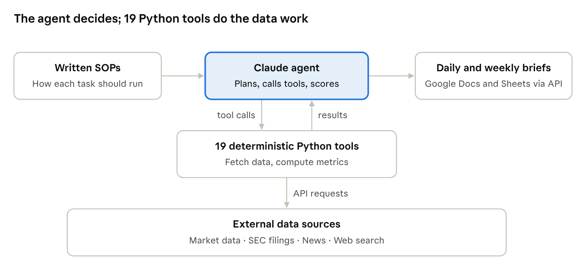
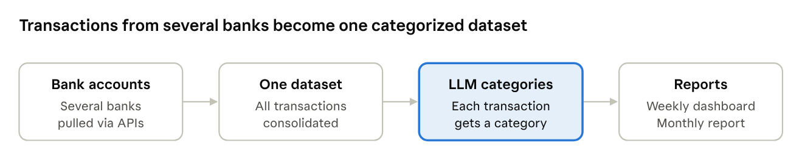
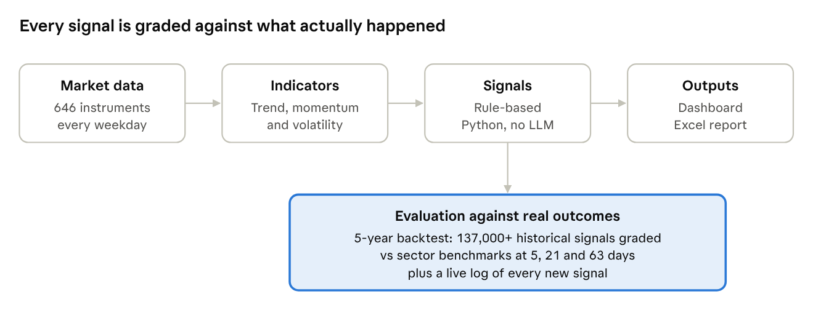

# Project Portfolio – Jaume Wäger Pons

Data engineer with experience in fintech (Clarity AI) and international luxury hospitality (Aman Group), based in Zug, Switzerland · [LinkedIn](https://linkedin.com/in/jaumewager)

These are three personal data engineering and AI projects I built in 2026 with Claude Code. They run on my own personal and financial data, so the code and data stay private. This page shows the architecture and the design choices behind each project. I am glad to walk through them in more detail in an interview.

## How I build

The same principles run through all three projects.

- **The LLM reasons, code executes.** Where AI is involved, the model makes judgments and deterministic Python does the data work, so every number can be traced and reproduced.
- **Connect through APIs.** Each project pulls from external sources (banks, market data, filings, news) through their APIs instead of manual exports.
- **Run on a schedule, without manual steps.** Pipelines refresh on their own and publish to the place people already look: a dashboard, an Excel report, Google Docs or Sheets.
- **Measure whether it works.** Outputs are checked against real outcomes, not just produced.
- **Write the process down.** The agent follows written SOPs, so its behaviour can be read, reviewed and changed like any other standard.

## 1. LLM agent with tool orchestration

A Claude agent that runs a daily and weekly research process on its own. It gathers market data, SEC filings, news and web results, scores candidates on a weighted rubric, and publishes briefs to Google Docs and Sheets.

Data fetching and calculations run in the tools, so the numbers in a brief come from code, not from the model.

**Design choices**

- **Written SOPs as the source of truth.** The agent follows documented procedures, so its behaviour can be reviewed and changed without touching code.
- **19 small, deterministic tools.** Each tool does one job (fetch a filing, compute a metric) and returns the same output for the same input, which makes failures easy to find.
- **Transparent scoring.** Candidates are ranked on a weighted rubric that combines computed metrics with the model's judgment, so every score can be explained.
- **Outputs where people read.** Briefs go straight to Google Docs and Sheets through their APIs, with no manual copy and paste.

**What it shows:** API-based integration, applying AI agents where they add practical value, and keeping AI output reliable and auditable. An agent calling well-defined tools is the same pattern the Model Context Protocol (MCP) standardises.

## 2. Multi-source data integration with LLM categorization

A pipeline that pulls transactions from several bank accounts through their APIs and consolidates them into one dataset. It then categorizes each transaction with an LLM and refreshes a weekly dashboard and a monthly report on spending, savings and investments.

The LLM only assigns categories; pulling, consolidating and reporting are plain code.

**Design choices**

- **Different sources, one dataset.** Transactions from each bank are brought into one consistent dataset before any analysis, so every report reads from the same place.
- **AI where rules fall short.** Free-text transaction descriptions are hard to categorize with fixed rules, so that one step uses an LLM.
- **Hands-off refresh.** The dashboard and report update on a schedule, with no manual exports.
- **Private by design.** The data stays on my side, which is also why the code is not public.

**What it shows:** connecting systems through APIs for reliable data exchange, structuring data from different sources into one model, and applying AI to data processing.

## 3. Automated market-data pipeline

A scheduled Python pipeline (pandas, NumPy) that pulls data for 646 instruments every weekday. It computes trend, momentum and volatility indicators, and publishes a dashboard and an Excel report.

The pipeline is pure code with no LLM; what makes it trustworthy is that its output is measured.

**Design choices**

- **Measured, not assumed.** A 5-year backtest grades more than 137,000 historical signals against sector benchmarks at three horizons (5, 21 and 63 days).
- **Ongoing monitoring.** A live log records the outcome of every new signal, so quality is tracked after launch, not only at build time.
- **Organised in watchlists.** The 646 instruments are grouped into 56 watchlists, each tracked on every run.
- **Outputs people can use.** Results land in a dashboard and an Excel report on every run.

**What it shows:** owning a pipeline end to end, from ingestion through ongoing improvement, and treating data quality as something to measure continuously.
